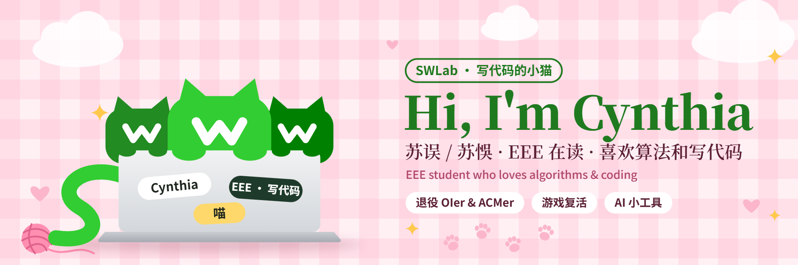
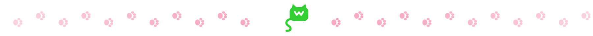

喵～欢迎来到 SWLab 的小角落 · welcome to my little cat lab

### 🐱 关于我

- 苏误，也写作苏悞
- EEE 在读，已退役的 OIer 和 ACMer（呜），但还是喜欢算法和写代码
- 正在做：让停服的手游重新活过来，给每个报 bug 的玩家一个回音，顺手写点让 Windows 好用一点的小脚本

### 🧶 小猫最近在忙

| | 项目 | 一句话 |
|:-:|---|---|
| 🎮 | [offline-game-revival](https://github.com/Cynthia-wlan9509/offline-game-revival) | 把停服手游改成离线纪念版的 AI agent skill，也能从截图和录屏里救回游戏数据 |
| 📮 | [hearback](https://github.com/Cynthia-wlan9509/hearback) | Discord 论坛 bug 反馈台：每个报 bug 的玩家都能收到回音 |
| 🪟 | [windows-11-practical-scripts](https://github.com/Cynthia-wlan9509/windows-11-practical-scripts) | 右键复制路径、Electron 应用 Ctrl+滚轮缩放 |
| ⚡ | [hand-crank-ac-generator](https://github.com/Cynthia-wlan9509/hand-crank-ac-generator) | 手摇发电机原型：绕线、示波器验证、带载测试 |

### 🐾 爪子常碰的东西

  
  
  
  
  
  
  

  

